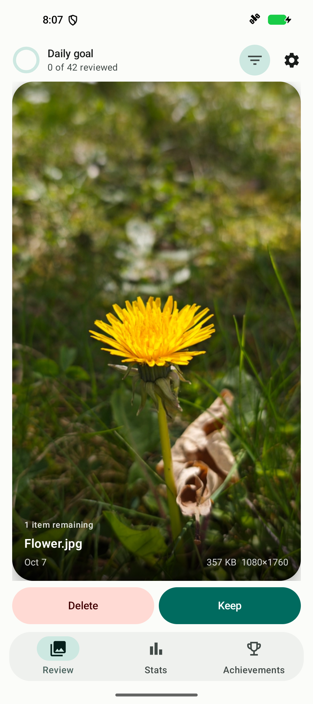
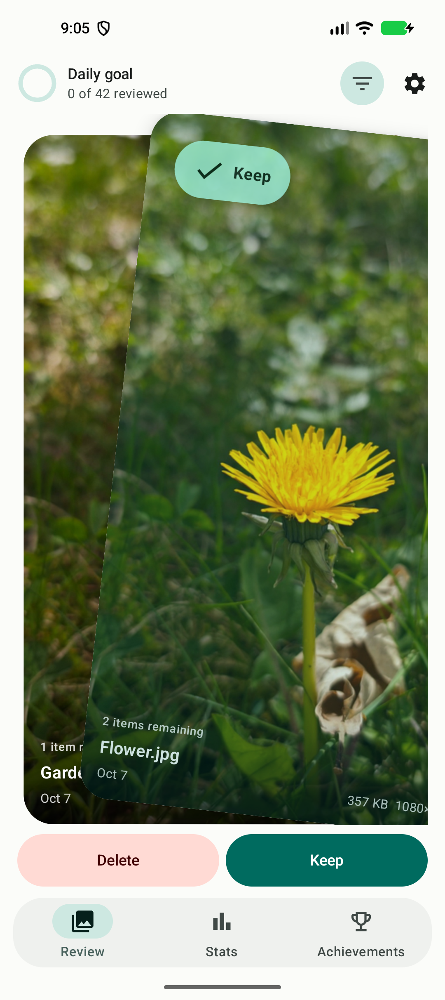
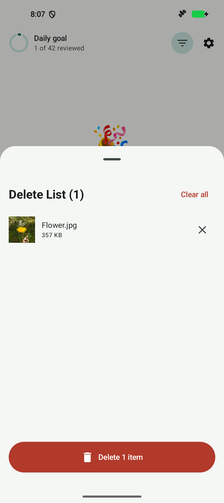
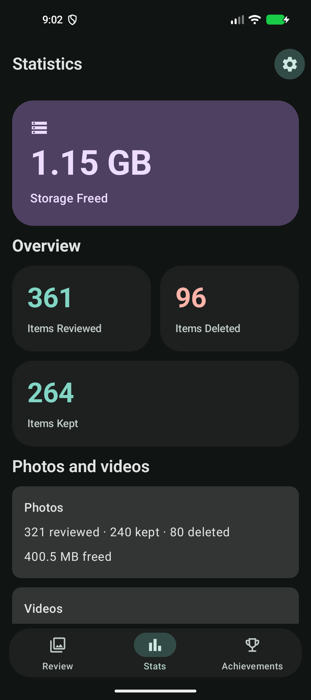
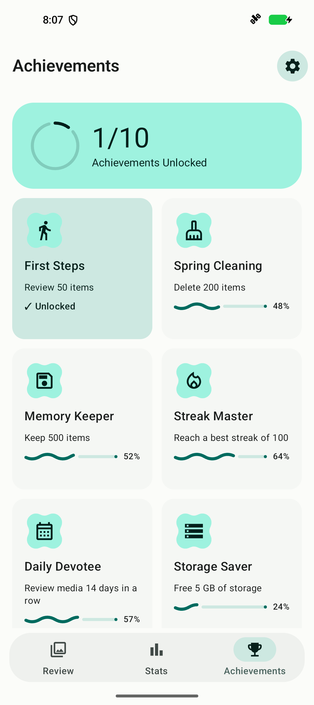
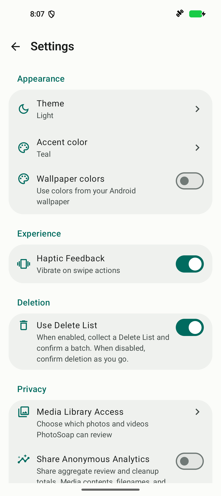

# PhotoSoap for Android

Photo and video cleanup for Android 9 and newer. Swipe through your library, keep the moments you love, and free up space.

[Android](https://github.com/DerMoha/PhotoSoapAndroid) · [iOS](https://github.com/DerMoha/PhotoSoap)

## Screenshots

  
  
  

  
  
  

Screens show the actual Android UI with sample photography and demo progress.

## What It Does

- Swipe right to keep photos and videos, or left to queue them for deletion.
- Check your delete list before confirming deletion.
- Browse by year, month, album, or media type.
- Track your review progress and storage freed.
- Build a cleanup habit with daily goals, streaks, and achievements.
- Choose light or dark mode, wallpaper colors, and accent palettes.

## Privacy

Photos and videos stay on your device. You control usage analytics during setup
and in Settings. Shared analytics contain aggregate review and cleanup totals,
never media contents, filenames, or locations.

## Contributing

Found a bug or have an idea? [Open an issue](https://github.com/DerMoha/PhotoSoapAndroid/issues).
